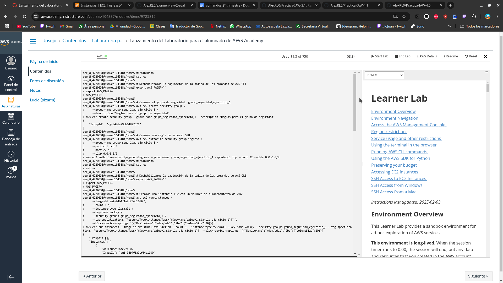
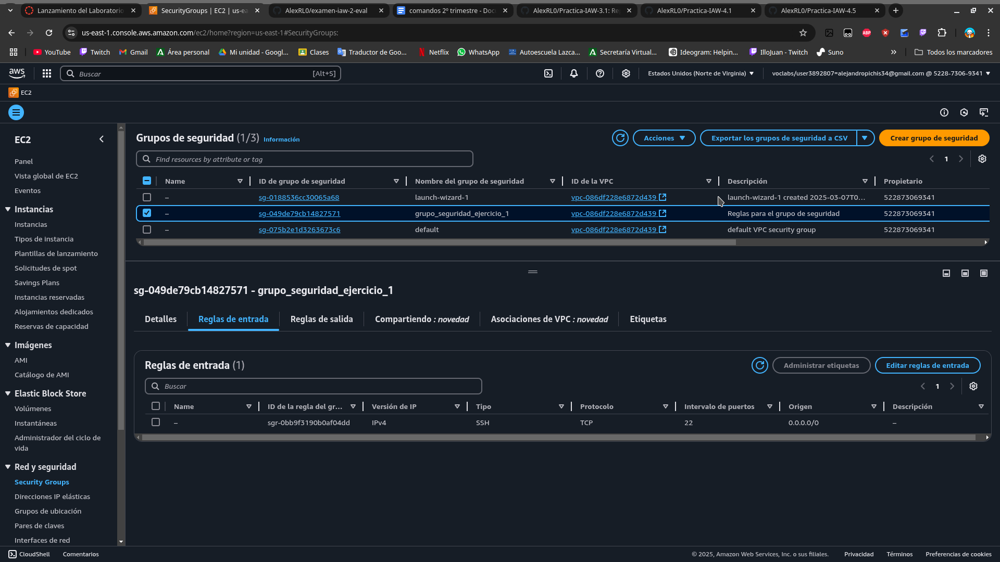
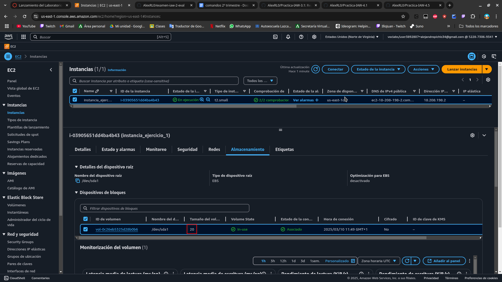
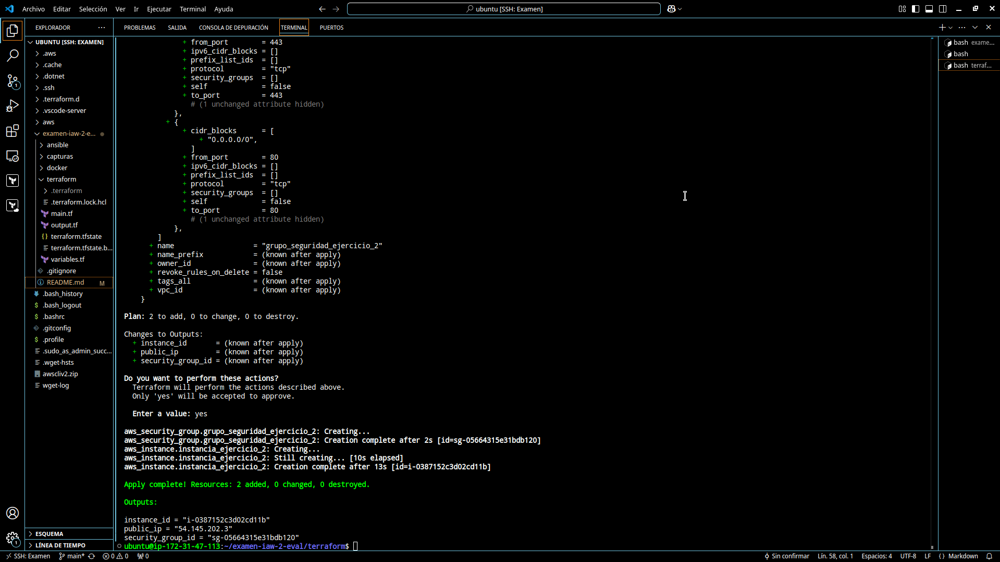
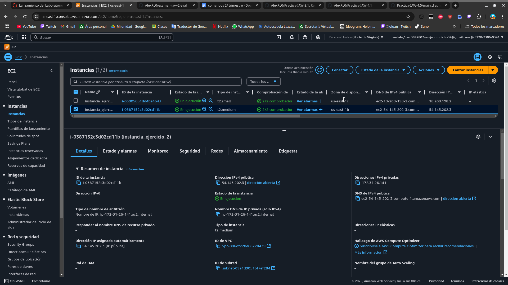
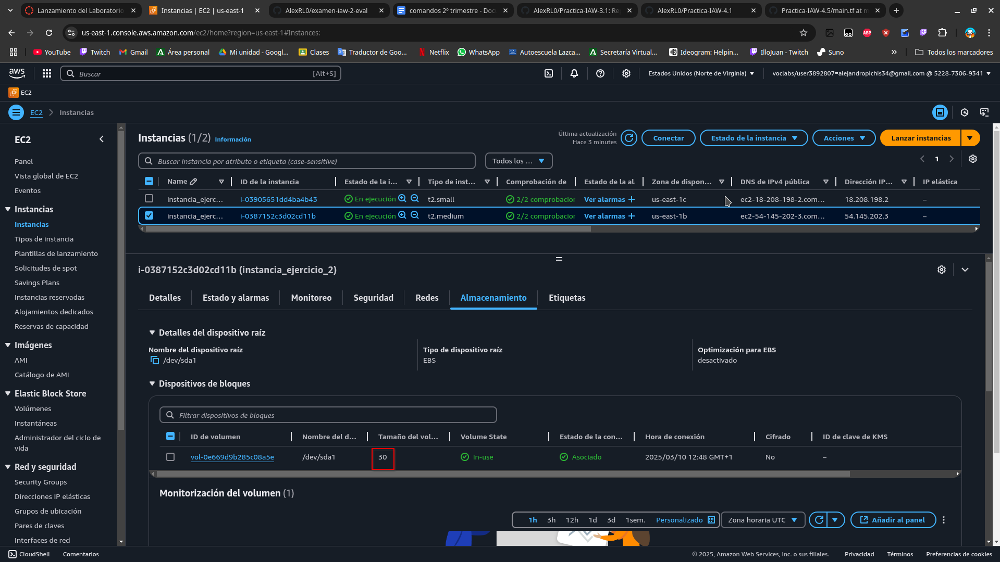
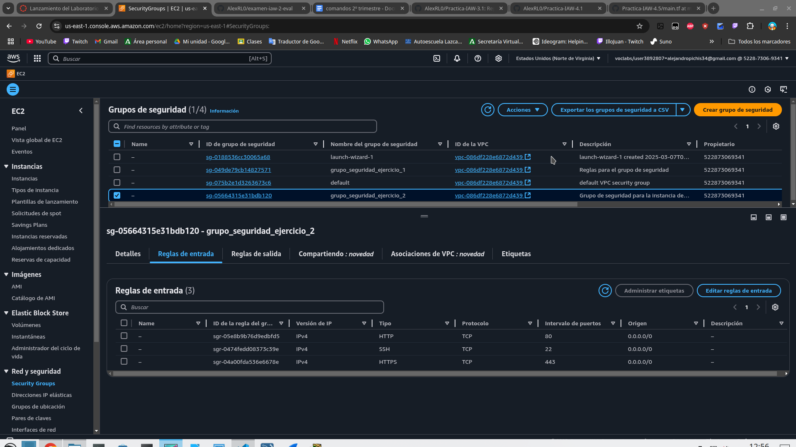
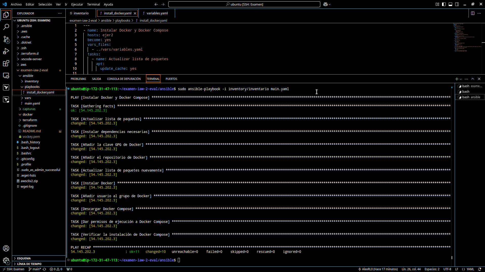

# examen-iaw-2-eval

# Ejercicio 1



```bash
#!/bin/bash
set -x

# Deshabilitamos la paginación de la salida de los comandos de AWS CLI
export AWS_PAGER=""

# Creamos el grupo de seguridad: grupo_seguridad_ejercicio_1
aws ec2 create-security-group \
    --group-name grupo_seguridad_ejercicio_1 \
    --description "Reglas para el grupo de seguridad"

# Creamos una regla de accesso SSH
aws ec2 authorize-security-group-ingress \
    --group-name grupo_seguridad_ejercicio_1 \
    --protocol tcp \
    --port 22 \
    --cidr 0.0.0.0/0
```




```bash
#!/bin/bash
set -x

# Deshabilitamos la paginación de la salida de los comandos de AWS CLI
export AWS_PAGER=""

# Creamos una instancia EC2 con un volumen de almacenamiento de 20GB
aws ec2 run-instances \
    --image-id ami-04b4f1a9cf54c11d0 \
    --count 1 \
    --instance-type t2.small \
    --key-name vockey \
    --security-groups grupo_seguridad_ejercicio_1 \
    --tag-specifications "ResourceType=instance,Tags=[{Key=Name,Value=instancia_ejercicio_1}]" \
    --block-device-mappings '[{"DeviceName":"/dev/sda1","Ebs":{"VolumeSize":20}}]'
```





# Ejercicio 2



# Archivo main.tf:

```bash
provider "aws" {
  region = var.region
}

# Crear el grupo de seguridad: grupo_seguridad_ejercicio_2
resource "aws_security_group" "grupo_seguridad_ejercicio_2" {
  name        = "grupo_seguridad_ejercicio_2"
  description = var.sg_description

  # Reglas de entrada
  ingress {
    from_port   = 22
    to_port     = 22
    protocol    = "tcp"
    cidr_blocks = ["0.0.0.0/0"]
  }

  ingress {
    from_port   = 80
    to_port     = 80
    protocol    = "tcp"
    cidr_blocks = ["0.0.0.0/0"]
  }

  ingress {
    from_port   = 443
    to_port     = 443
    protocol    = "tcp"
    cidr_blocks = ["0.0.0.0/0"]
  }

  # Reglas de salida
  egress {
    from_port   = 0
    to_port     = 0
    protocol    = "-1"
    cidr_blocks = ["0.0.0.0/0"]
  }
}

# Crear la instancia EC2: instancia_ejercicio_2
resource "aws_instance" "instancia_ejercicio_2" {
  ami           = var.ami_id
  instance_type = var.instance_type
  key_name      = var.key_name

  # Configurar el almacenamiento
  root_block_device {
    volume_size = 30
  }

  vpc_security_group_ids = [aws_security_group.grupo_seguridad_ejercicio_2.id]

  tags = {
    Name = "instancia_ejercicio_2"
  }
}
```

# Archivo variables.tf:

```bash
# Variables
variable "region" {
  description = "Región de AWS donde se creará la instancia"
  type        = string
  default     = "us-east-1"
}

variable "sg_description" {
  description = "Descripción del grupo de seguridad"
  type        = string
  default     = "Grupo de seguridad para la instancia de ejercicio 2"
}

variable "ami_id" {
  description = "Identificador de la AMI"
  type        = string
  default     = "ami-00874d747dde814fa"  
}

variable "instance_type" {
  description = "Tipo de instancia"
  type        = string
  default     = "t2.medium"
}

variable "key_name" {
  description = "Nombre de la clave pública"
  type        = string
  default     = "vockey"
}
```

# Archivo output.tf:

```bash
# Salidas
output "instance_id" {
  description = "El ID de la instancia"
  value       = aws_instance.instancia_ejercicio_2.id
}

output "public_ip" {
  description = "La IP pública de la instancia"
  value       = aws_instance.instancia_ejercicio_2.public_ip
}

output "security_group_id" {
  description = "El ID del grupo de seguridad"
  value       = aws_security_group.grupo_seguridad_ejercicio_2.id
}
```









# Ejercicio 3




# Ejercicio 4


