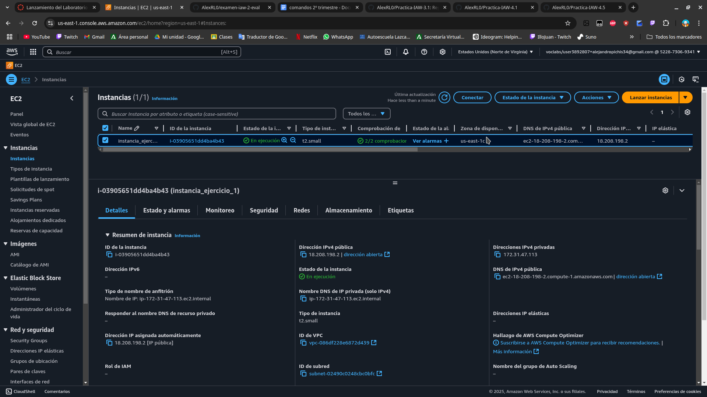

# examen-iaw-2-eval

# Ejercicio 1


```bash
#!/bin/bash
set -x

# Deshabilitamos la paginación de la salida de los comandos de AWS CLI
export AWS_PAGER=""

# Creamos el grupo de seguridad: grupo_seguridad_ejercicio_1
aws ec2 create-security-group \
    --group-name grupo_seguridad_ejercicio_1 \
    --description "Reglas para el grupo de seguridad"

# Creamos una regla de accesso SSH
aws ec2 authorize-security-group-ingress \
    --group-name grupo_seguridad_ejercicio_1 \
    --protocol tcp \
    --port 22 \
    --cidr 0.0.0.0/0
```


```bash
#!/bin/bash
set -x

# Deshabilitamos la paginación de la salida de los comandos de AWS CLI
export AWS_PAGER=""

# Creamos una instancia EC2 con un volumen de almacenamiento de 20GB
aws ec2 run-instances \
    --image-id ami-04b4f1a9cf54c11d0 \
    --count 1 \
    --instance-type t2.small \
    --key-name vockey \
    --security-groups grupo_seguridad_ejercicio_1 \
    --tag-specifications "ResourceType=instance,Tags=[{Key=Name,Value=instancia_ejercicio_1}]" \
    --block-device-mappings '[{"DeviceName":"/dev/sda1","Ebs":{"VolumeSize":20}}]'
```




# Ejercicio 2
